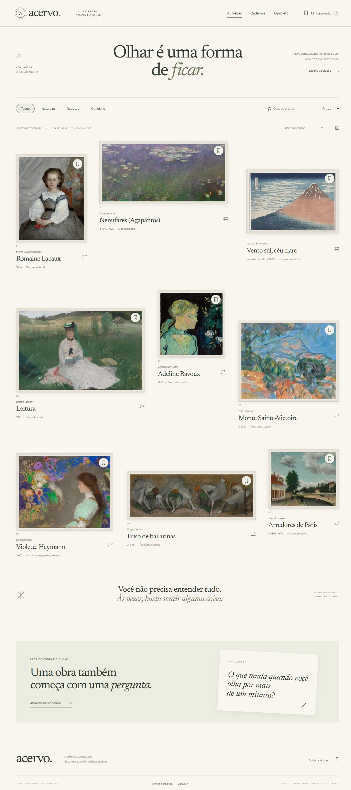

# Acervo

Uma galeria digital para demorar o olhar. Nove obras, leituras curatoriais e um caderno pessoal de encontros.

**[Explore a demonstração →](https://gustapaz.github.io/acervo/)**



## O que está completo

- Coleção em parede assimétrica ou grade alinhada.
- Busca sem distinção de acentos e filtros combinados por tema, técnica e artista.
- Ordenação por curadoria, data ou artista, com a mesma ordem no DOM e no teclado.
- Nove páginas de obras com ficha, fonte original, leitura interpretativa e recomendações relacionadas.
- Sala de observação com ampliação de até 300% e rolagem por toque ou teclado.
- Seleção pessoal com notas de até 1.500 caracteres, persistência local e impressão do caderno.
- Comparação de duas obras, com escolha mantida entre páginas na sessão do navegador e URL que pode ser compartilhada.
- Três cadernos editoriais com controles de tamanho do texto e progresso de leitura.
- Página do projeto, créditos, perguntas frequentes e página 404.

## Uma stack e uma composição diferentes

**Eleventy 3 + Nunjucks + Alpine.js 3 + Vite 8 + CSS.** O HTML é gerado estaticamente, e o JavaScript adiciona interações no cliente. O estilo mistura catálogo de museu e caderno editorial: margens generosas, Newsreader serifada, molduras, obras com proporções próprias e intervalos assimétricos. [Decisões de layout, mobile e movimento](docs/design.md).

As 18 páginas HTML incluem 9 obras, 3 ensaios, coleção, índice de cadernos, seleção, comparação, projeto e 404. SEO inclui títulos e descrições específicos, canonical por página, metadados sociais, sitemap e conteúdo de leitura disponível no HTML sem JavaScript.

## Somente front-end, gratuito

O produto e a curadoria são demonstrativos. Não há museu real operando neste site, login, API em execução, backend, banco remoto, venda, reserva ou integração paga. As obras e os dados de identificação são fixtures locais baseadas em registros abertos do Cleveland Museum of Art; as imagens e as fontes são hospedadas com o projeto.

Favoritos e notas ficam em `localStorage`; a seleção para comparar usa `sessionStorage`. Nenhuma nota é enviada a um servidor. Limpar os dados do site apaga sua seleção. Não há sincronização entre dispositivos; o caderno pode ser impresso ou salvo em PDF pelo navegador. Se o armazenamento não estiver disponível, a interface informa a limitação.

## Executar

Node.js 24 ou superior.

```sh
npm ci
npm run dev
```

O endereço local é `http://localhost:5183/acervo/`. O comando gera o site e inicia os watchers de Eleventy e Vite.

```sh
npm run build
npm test
```

Os testes de saída precisam do build: verificam os links e arquivos locais, as páginas estáticas, os registros CC0 e os tamanhos das imagens. Os testes de lógica verificam busca, filtros, ordenação, validação da seleção, notas e parâmetros de comparação.

## Publicação

GitHub Pages, com workflow que executa `npm ci`, build e testes antes de publicar `dist/`. Não há segredo ou chave de aplicação. A base de rotas é `/acervo/`; ajuste a base do Eleventy, Vite, URLs do cliente e metadados se mudar o nome do repositório.

## Recursos e licenças

As reproduções foram selecionadas apenas de registros com `share_license_status: CC0` no catálogo oficial do [Cleveland Museum of Art](https://www.clevelandart.org/open-access). [Registro de fontes, créditos, medidas e hashes](docs/sources.json). As imagens WebP em 640 e 1.600 pixels são versionadas, e o build normal não acessa APIs. Para regenerá-las, `npm run assets` consulta as URLs registradas; não precisa de chave. Os títulos em português são traduções editoriais. As leituras e ensaios são textos próprios do projeto, separados dos dados históricos do catálogo.

Código: [MIT](LICENSE), Gustavo Paz. Fontes: [Newsreader](docs/LICENSE-Newsreader.txt) e [Manrope](docs/LICENSE-Manrope.txt), SIL Open Font License. Dependências preservam suas próprias licenças.

## Validação e limites

[Verificações realizadas](docs/validacao.md). As páginas foram revisadas em Chromium com desktop, mobile, teclado, estados vazios, notas e comparação. A reprodução ampliada tem no máximo 1.600 pixels de largura e não substitui o arquivo original do museu. A escala da comparação é visual e não representa a dimensão física das obras. Não foram medidos escores Lighthouse nem feita auditoria com leitor de tela ou teste em aparelhos físicos.

